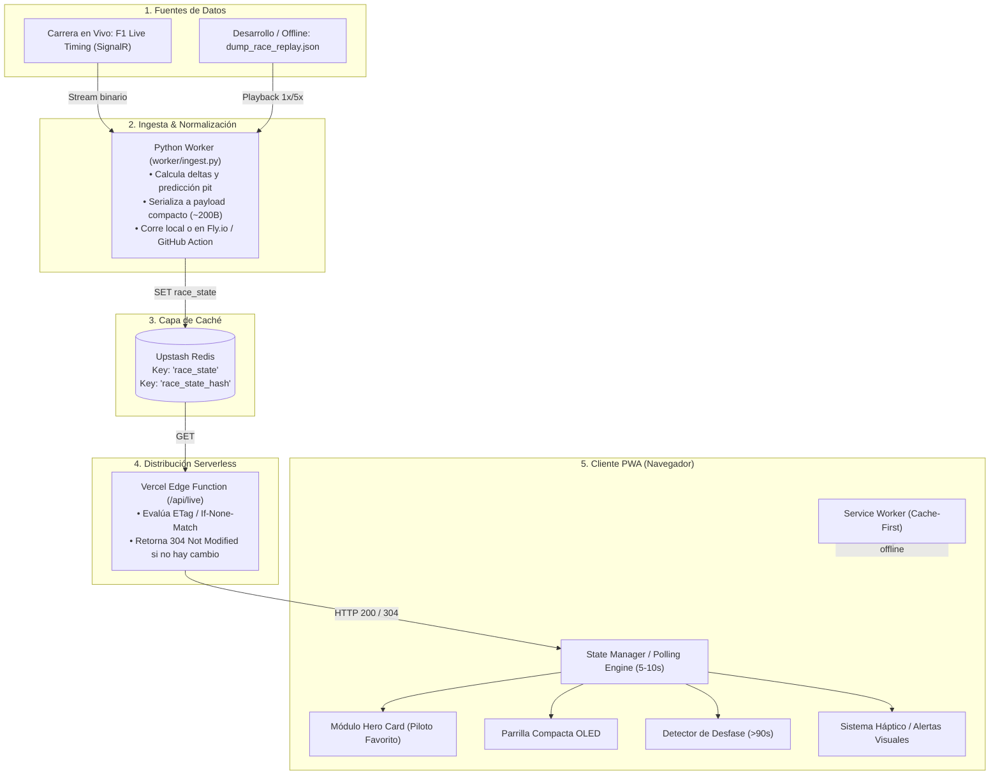
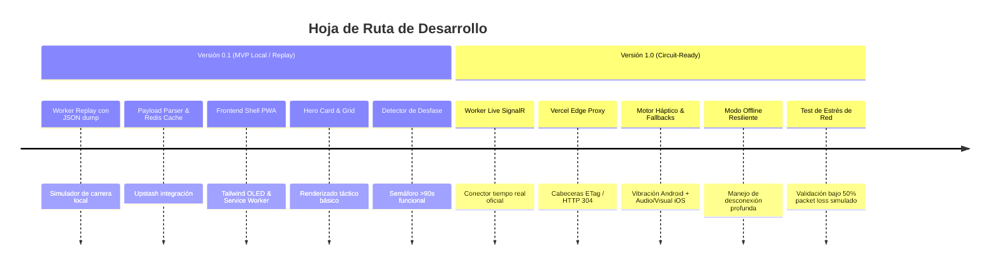

# Trackside Pulse — Technical Specification & Agent Implementation Blueprint

> **Versión:** 1.0.0  
> **Estado:** Aprobado para desarrollo  
> **Público objetivo del documento:** Desarrolladores e Inteligencias Artificiales de programación autónoma.

---

## 1. Visión del Producto y Propuesta de Valor

**Trackside Pulse** es una Progressive Web App (PWA) de código abierto diseñada para espectadores presenciales en autódromos de Fórmula 1.

### El Problema a Resolver
1. **Saturación Extrema de Red:** 100.000+ personas consumiendo la misma antena 4G/5G causan pérdida masiva de paquetes, latencias de >5000 ms y caída de WebSockets.
2. **Pérdida de Contexto:** El ruido acústico supera los 100 dB (imposible oír megafonía) y las pantallas del circuito suelen estar distantes o no ofrecen deltas tácticos legibles bajo sol directo.
3. **Apps Tradicionales Inutilizables:** La app oficial de F1 pesa cientos de megabytes y consume streams de video o telemetría continua pesada que colapsan en el autódromo.

### La Solución
Un visor táctico de **ultra-bajo ancho de banda** (<500 bytes por actualización), orientado a texto/datos fácticos, con estrategia **Cache-First**, interfaz OLED monocromática de alto contraste, y resistencia nativa a cortes de señal.

---

## 2. Diagrama de Arquitectura de Datos



---

## 3. Stack Tecnológico Definitivo

| Capa | Tecnología | Justificación Técnica |
| :--- | :--- | :--- |
| **Worker / Ingesta** | Python 3.11+ (`requests`, `websockets`, `signalrcore`) | Conexión directa a SignalR; procesamiento matricial sin Pandas. Modo dual: `--live` y `--replay`. |
| **Memoria / Caché** | **Upstash Redis** (Tier Free) | Acceso REST nativo ultra-rápido, sin servidores dedicados, compatible con Edge functions. |
| **Edge API / Proxy** | **Vercel Edge Function** (Node.js o Edge Python) | 0 cold-start, computación en el borde global, soporte nativo de cabeceras HTTP `ETag` / `304`. |
| **Frontend Core** | **HTML5 Semántico + Vanilla JS (ES Modules)** | Cero overhead de frameworks (sin React/Vue) para garantizar renderizado instantáneo en teléfonos de gama baja. |
| **Estilos** | **Tailwind CSS (Build estático)** | Interfaz oscura OLED (`#000000`), clases utilitarias para alto contraste y mínimo CSS (~8 KB comprimido). |
| **PWA / Offline** | **Service Worker nativo (Cache-First)** | Carga 100% offline de la shell, fuentes, circuito y lista de pilotos. |
| **Datos Estáticos** | `season_data.json` (~8 KB) | Información inmutable anual (pilotos, dorsales, colores HEX, delta de pit lane por circuito). |

---

## 4. Especificación del Protocolo y Schemas de Datos

### 4.1. Payload Compacto en Redis (`race_state`)
El payload que viaja por la red utiliza claves abreviadas y arrays posicionales para reducir drásticamente el tamaño:

```json
{
  "lap": 44,
  "total": 57,
  "flag": "GREEN",
  "ts": 1718002341,
  "pit_delta": 23.5,
  "drivers": [
    ["VER", 1, "+0.000", "M", 16, 0, 0],
    ["NOR", 2, "+1.840", "H", 22, 0, 1],
    ["LEC", 3, "+5.210", "H", 24, 1, 0]
  ],
  "ticker": [
    "V43: HAM pit stop (2.3s) - Reingreso P6",
    "V40: Bandera amarilla Sector 2"
  ]
}
```

#### Diccionario de Datos del Vector `drivers`:
* `[0]` **Código** (`string`): Código oficial de 3 letras (ej. `"VER"`).
* `[1]` **Posición** (`int`): Posición en pista (1 a 20).
* `[2]` **Delta** (`string`): Intervalo con el auto de adelante (o tiempo total para P1).
* `[3]` **Compuesto** (`string`): `"S"` (Soft), `"M"` (Medium), `"H"` (Hard), `"I"` (Inter), `"W"` (Wet), `"U"` (Unknown).
* `[4]` **Vida del neumático** (`int`): Vueltas acumuladas con el juego actual.
* `[5]` **En Pit** (`0 | 1`): `1` si el vehículo se encuentra físicamente en el pit lane.
* `[6]` **Tendencia** (`-1 | 0 | 1`): `-1` perdiendo tiempo, `0` estable, `1` descontando tiempo al coche de adelante.

> [!NOTE]
> Tamaño estimado sin comprimir: **~420 bytes**. Con compresión Brotli en HTTP: **~180 bytes**.

---

### 4.2. Schema Estático Local (`season_data.json`)
Almacenado localmente en el cliente (no se descarga durante la carrera):

```json
{
  "drivers": {
    "VER": { "name": "M. Verstappen", "num": 1, "color": "#3671C6" },
    "NOR": { "name": "L. Norris", "num": 4, "color": "#FF8000" },
    "LEC": { "name": "C. Leclerc", "num": 16, "color": "#E80020" },
    "HAM": { "name": "L. Hamilton", "num": 44, "color": "#E80020" }
  },
  "circuits": {
    "monza": { "name": "Monza", "pit_loss_sec": 24.0, "total_laps": 53 },
    "silverstone": { "name": "Silverstone", "pit_loss_sec": 21.5, "total_laps": 52 }
  }
}
```

---

## 5. Especificación Funcional de Componentes

### 5.1. Módulo Hero Card (Piloto Favorito)
* **Objetivo:** Mostrar de un vistazo toda la información crítica del piloto que sigue el aficionado.
* **Cálculo de Salida de Boxes Estimada (Pit Window Prediction):**
  $$\text{Gap Acumulado} = \sum \text{deltas}$$
  El cliente calcula la posición en la que caería el piloto si para en la vuelta actual usando `pit_loss_sec` configurado para el circuito:
  * Resta `pit_loss_sec` a la brecha temporal acumulada con los autos por detrás.
  * Determina entre qué pilotos reingresaría a pista (ej. *"Si entra ahora: Sale P6 detrás de HAM"*).
* **Resalte Táctico:** Indicador de compuesto y vueltas de neumático en tipografía de alto contraste (amarillo para Medium, blanco para Hard, rojo para Soft).

### 5.2. Parrilla Compacta OLED
* Vista vertical estricta (1 fila por piloto).
* Fondo `#000000` estricto (apaga píxeles en pantallas OLED para ahorrar batería y maximizar visibilidad bajo sol).
* Sin scroll horizontal. Solo métricas indispensables: Posición, Sigla, Neumático + Vueltas, Delta.

### 5.3. Teletipo Táctico de Incidencias
* Lista plana de texto de los últimos 5 eventos reportados por Dirección de Carrera.
* Sin imágenes ni animaciones. Solo texto conciso de alto contraste.

### 5.4. Detector Inteligente de Desfase (>90s)
* Si `(Date.now() / 1000) - payload.ts > 90`:
  * La app despliega una barra superior de advertencia en color ámbar/rojo:  
    `⚠️ DATOS DESFASADOS - VUELTA CONGELADA (Última señal hace Xs)`
  * Se congela el cálculo de salida de boxes para evitar engañar al usuario.
* Si el teléfono recupera conexión y recibe un payload con `ts` fresco, el indicador vuelve automáticamente a verde (`🟢 EN VIVO`).

### 5.5. Sistema Háptico & Fallback Multiplataforma
* **Android (Chrome/Edge):**
  * Parada en boxes del favorito: `navigator.vibrate([150, 50, 150])`
  * Bandera Amarilla / SC / VSC: `navigator.vibrate([300, 100, 300])`
  * Abandono / Bandera Roja: `navigator.vibrate([500, 200, 500])`
* **iOS (Safari / PWA WebKit):**
  * `navigator.vibrate` está deshabilitado por Apple.
  * **Fallback 1:** Flash visual en el viewport (borde blanco parpadeante de alto contraste).
  * **Fallback 2:** Tono discreto de 440 Hz sintetizado con `Web Audio API` (si el usuario habilitó alertas auditivas).

---

## 6. Blindaje Legal y Compliance (FOM)

Para garantizar la viabilidad del proyecto de código abierto y evitar reclamos de propiedad intelectual de Formula One Management:
1. **Identidad:** Nombre exclusivo: `Trackside Pulse`. Prohibido el uso de "F1", "Formula 1" o "Grand Prix" en nombres de paquete o dominios.
2. **Logotipos:** Cero logotipos oficiales de marcas, equipos o de la F1.
3. **Escuderías:** Identificación exclusiva mediante colores hexadecimales representativos y siglas de tres letras de los pilotos (`VER`, `NOR`, `ALO`).
4. **Datos:** Tiempos y posiciones constituyen información fáctica deportiva de dominio público.

---

## 7. Roadmap de Entregas



### Alcance Versión 0.1 (MVP / Prototipo Funcional)
* [ ] Archivo `dump_monza_replay.json` con 10 vueltas completas de telemetría fáctica.
* [ ] Worker Python en modo `--replay` que inyecta a Redis cada $X$ segundos simulando una carrera.
* [ ] PWA funcional en navegador con Tailwind CSS.
* [ ] Selector de piloto favorito con persistencia en `localStorage`.
* [ ] Hero Card con deltas y predicción de salida de parada.
* [ ] Parrilla vertical con los 20 pilotos.
* [ ] Semáforo visual de desfase temporal (>90s).

### Alcance Versión 1.0 (Producción en Circuito)
* [ ] Worker Python en modo `--live` conectándose al hub SignalR de F1 Live Timing.
* [ ] Proxy Edge en Vercel con validación de cabecera `If-None-Match` (respuestas 304 de 0 bytes).
* [ ] Service Worker completo con estrategia Cache-First para toda la shell de la aplicación.
* [ ] Sistema de vibración háptica para Android y fallback visual/sonoro para iOS.
* [ ] Certificación PWA (manifest, iconos en blanco y negro de alto contraste, offline installable).
* [ ] Pruebas en condiciones de red degradada (usando throttling de Chrome DevTools: Slow 3G + 30% drop rate).

---

## 8. Estructura de Archivos del Proyecto

```text
trackside-pulse/
├── README.md
├── LICENSE (MIT)
├── package.json
├── vercel.json
├── api/
│   └── live.js                  # Edge function Vercel (Upstash Redis + ETag)
├── worker/
│   ├── requirements.txt         # requests, websockets, signalrcore
│   ├── ingest.py                # Worker principal (modos --live y --replay)
│   ├── f1_signalr.py            # Parser ligero del stream SignalR
│   └── data/
│       └── replay_sample.json   # Grabación de carrera para pruebas
├── public/
│   ├── index.html               # Shell HTML monocromática
│   ├── manifest.json            # Manifiesto PWA
│   ├── sw.js                    # Service Worker (Cache-First)
│   ├── static/
│   │   ├── css/
│   │   │   └── tailwind.css     # Estilos utilitarios OLED
│   │   ├── js/
│   │   │   ├── app.js           # Lógica cliente y polling ETag
│   │   │   ├── haptics.js       # Vibración y fallbacks iOS
│   │   │   └── state.js         # Estado reactivo local
│   │   └── data/
│   │       └── season_data.json # Pilotos, dorsales, colores y circuitos
│   └── icons/
│       ├── icon-192.png
│       └── icon-512.png
```

---

## 9. Criterios de Aceptación para el Agente Implementador

1. **Eficiencia de Ancho de Banda:** Cada llamada exitosa a `/api/live` sin cambios en la vuelta debe devolver un código `304 Not Modified` con un cuerpo de respuesta de 0 bytes.
2. **Cero Dependencias Pesadas en Frontend:** No incorporar React, Vue, Angular o librerías de componentes pesadas. Usar JavaScript nativo modular.
3. **Resistencia Offline:** Si la red se desconecta por completo, la app debe permanecer interactiva, mostrando el último estado conocido y activando el banner de datos congelados sin romper la interfaz.
4. **Compatibilidad Visual:** Contraste mínimo de texto WCAG AAA (mínimo 7:1) para legibilidad bajo luz solar directa.
